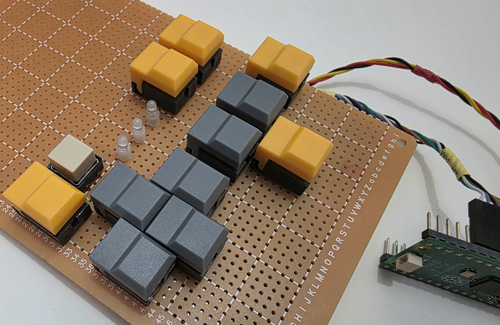
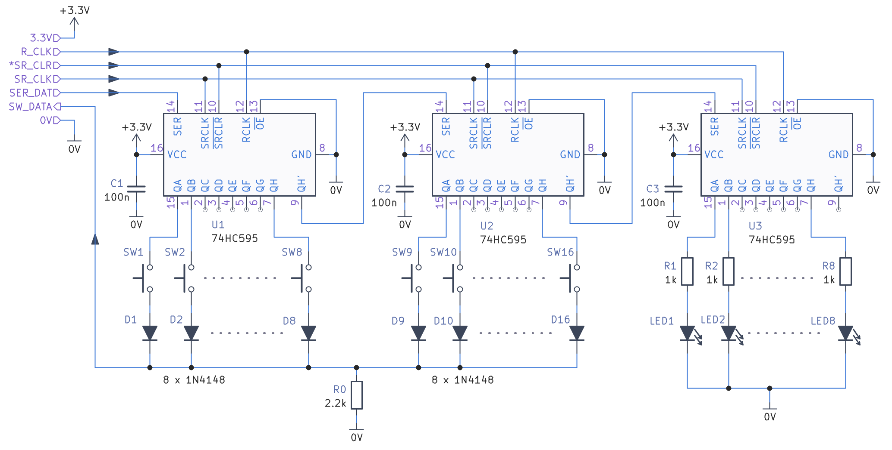

# Simple Keypad with LEDs

This repository contains the circuit diagram, and a test program (tested on Pi Pico) for scanning up to **16 buttons** and driving up to **eight indicator LEDs** using three daisy-chained **74HC595** shift registers. Note: search on AliExpress for a ready-made 3 x 74HC595 board, and then all you need are switches, diodes and a few resistors. The buttons used for the prototype are google'able using the search term "PB86 switch".

The first two 74HC595s select buttons one at a time. A common switch/diode sense line is read by the microcontroller. The third 74HC595, appended at the far end of the serial chain, drives the LEDs. The test program reports the two button bytes over USB serial and cycles the LEDs through binary values 0–7.



## Pico connections

The GPIO numbers below are **GP numbers**, not physical header-pin numbers.

| Pico GPIO | Pico physical pin | Connection | 74HC595 pin |
|---|---:|---|---:|
| **GP7** | **10** | Serial data (`SER_DAT` / DS) to first 595 | 14 |
| **GP8** | **11** | Shift clock (`SR_CLK` / SHCP), shared by all 595s | 11 |
| **GP9** | **12** | Button sense input (`SW_DATA`), from common switch/diode line | — |
| **GND** | **13** | Common ground | 8 |
| **GP10** | **14** | Active-low shift-register clear (`/SR_CLR`), shared by all 595s | 10 |
| **GP11** | **15** | Output latch clock (`R_CLK` / STCP), shared by all 595s | 12 |
| **3V3(OUT)** | **36** | 3.3 V supply for the 595s | 16 |
| **GP25** | Onboard only | Original Pico's built-in status LED | — |


All three 74HC595s operate at 3.3 V, with common ground to the Pico. Connect **`/OE` (pin 13) to GND** on each 595 to enable its outputs. The program drives `/SR_CLR` high during normal operation.

## Circuit Diagram

Connect as shown here:



The three chips share GP8 (shift clock), GP10 (`/SR_CLR`) and GP11 (latch clock). Their VCC pins (16) go to 3.3 V, and GND pins (8) go to ground.

### Button inputs

The first two chips use outputs Q0–Q7 to select the 16 buttons sequentially. The switch/diode network feeds a common sense line into **GP9**. Fit an **external pull-down resistor from GP9 to GND** so that an unpressed input reads low. The circuit assumes a pressed button connects a selected **high** output to the sense line through a correctly oriented diode (anode toward the selected output, cathode toward GP9).

The prototype uses a **2.2 kΩ** pull-down; avoid larger resistances, because they slow down how fast the line can drop to logic '0'. 

### LED outputs

The third (last) 74HC595 drives the three LEDs:

| LED bit | 74HC595 output | Chip pin |
|---|---|---:|
| Bit 0 (least significant) | QA | **15** |
| Bit 1 | QB | **1** |
| Bit 2 | QC | **2** |

As shown in the circuit, use a **separate current-limiting resistor for each LED**. The suggested resistor is 1k, because that usually provides plenty of indicator brightness with modern LEDs.

## Test operation

1. Power the Pico and the 74HC595s from the same 3.3 V logic supply, with a common ground.
2. Build and flash the Pico SDK test program.
3. Open the Pico's USB serial output. The program prints the two scanned button bytes, for example:

   ```text
   val: 0x00 0x01
   ```

4. Press each button and check that the corresponding bit changes.
5. Observe the three LEDs cycling through binary `000` to `111`, advancing approximately every **500 ms** (the program pauses around 100 ms between scans).

